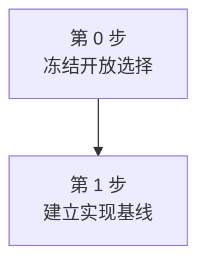

# Experiment Plan Loop

Turn **$ARGUMENTS** into reviewable plan rounds and one compact final document that a junior
researcher can execute experiment by experiment. Plan experiments; do not run them unless the user
separately asks.

## Constants

- `OUTPUT_DIR = experiments-plan-stage/<slot>`
- `ROUND_PLAN = ROUND_<NN>_EXPERIMENT_PLAN.md`
- `ROUND_REVIEW = ROUND_<NN>_REVIEW.md`
- `ROUND_BUG_LIST = ROUND_<NN>_BUG_LIST.md` (optional)
- `FINAL_PLAN = FINAL_EXPERIMENT_PLAN.md`
- `FINAL_GUIDE = ENGINEERING_EXECUTION_GUIDE.md`
- `MAX_PRIMARY_CLAIMS = 10`
- `MAX_CORE_EXPERIMENTS = 10`
- `MAX_BASELINE_FAMILIES = 10`
- `DEFAULT_SEEDS = 3`
- `PASS_THRESHOLD = 8.0` (strictly greater)
- `REVIEW_ROUND_LIMIT = 3` (stop after rounds if PASS_THRESHOLD not reached)
- If you write any documents, please write them in Chinese.
- You are planner, Don't run any code.
- This server is not my last-used instance; therefore, please ignore all computational resource limitations.

## Output Contract

Create only these files for each round `NN`:

```text
experiments-plan-stage/<slot>/ROUND_<NN>_EXPERIMENT_PLAN.md
experiments-plan-stage/<slot>/ROUND_<NN>_REVIEW.md
experiments-plan-stage/<slot>/ROUND_<NN>_BUG_LIST.md  # only for real expansion blockers
```

Never exceed three files for one round. Use `assets/EXPERIMENT_PLAN.md` as each round-plan structure
and `assets/BUG_LIST.md` only when needed. The reviewer uses the `REVIEW.md` contract from
`review-experiment-plan`. Preserve completed rounds read-only; do not create context files,
separate claim/method files, trackers, state JSON, review subdirectories, revision logs, manifests,
or timestamped duplicates.

After a round passes, copy its plan content to:

```text
experiments-plan-stage/<slot>/FINAL_EXPERIMENT_PLAN.md
```

Then write the engineering handoff to:

```text
experiments-plan-stage/<slot>/ENGINEERING_EXECUTION_GUIDE.md
```

The final plan and engineering guide are not round artifacts and do not count against the
three-file round limit. They are the only two final reader-facing results. Do not create a final
review, final bug list, tracker, state file, manifest, timestamped duplicate, or other final
companion file.

Do not use Markdown tables, Mermaid, diagrams, embedded images, or generated charts in any round
plan, review, bug list, or `FINAL_EXPERIMENT_PLAN.md`. Bullets and numbered lists are allowed. When
the paper should eventually contain a table or figure, describe that future artifact in prose; do
not render it in the plan. The sole exception is the required Mermaid dependency/concurrency
flowchart at the end of `ENGINEERING_EXECUTION_GUIDE.md`; do not add any other table, diagram,
embedded image, or generated chart to that guide.

Do not add process metadata inside plan or review content. Put the round number only in filenames.
Omit slot labels, input idea/code paths, draft dates, generic experiment-status banners, timestamps,
agent IDs, content hashes, and review-history summaries. Keep scientifically relevant provenance
only where it affects the experiment: dataset versions in Section 3, method commits in Section 5,
and predeclared thresholds inside the relevant metric or numbered experiment.

## Inputs and Evidence

Resolve and read:

- `IDEA_PATH`: the complete proposal or improved idea;
- `CODE_PATH`: the existing implementation, baseline fork, or minimum-demo code;
- `SLOT`: infer from the idea/project when omitted;
- `DEMO_EVIDENCE`: raw results, tests, logs, or the user's statement that the minimum demo passed;
- available compute, model/API/data access, deadline, and target venue when known.

Inspect the code deeply enough to identify entrypoints, current data/metric implementations,
method interfaces, reusable demo components, and whether those components can support the full
experiment program. Treat a successful minimum demo as feasibility evidence, not a paper result.

Use current primary sources when method recency, representativeness, repository availability, or
license can have changed. Prefer official papers, repositories, benchmark pages, and releases.
Record links, access date, version/commit, compatibility, adaptation effort, and selection reason
in prose. Mark unresolved claims as unverified; never fabricate them.

## Write Each Round Plan

The first five level-two headings of every `ROUND_<NN>_EXPERIMENT_PLAN.md` and the final plan must
be exactly these topics and in this order. Do not place another level-two heading before them.

### 1. Paper Claims

Freeze before designing experiments:

- the primary mechanism-level claim;
- an optional supporting claim only when it strengthens the same paper story;
- anti-claims to rule out, such as gains caused only by more parameters, more calls/compute, a
  larger search space, prompt length, leakage, evaluator artifacts, or decorative modern methods;
- the minimum convincing evidence needed for each claim.

Use stable claim IDs in prose. Do not exceed `MAX_PRIMARY_CLAIMS` unless the claims are genuinely
inseparable.

### 2. Experimental Storyline

Build a compact claim-to-evidence story around only the necessary blocks:

1. main anchor result: does the method solve the actual bottleneck?
2. novelty isolation: does the dominant contribution itself matter?
3. simplicity/elegance check: can unnecessary complexity be avoided?
4. frontier necessity check: when an LLM/VLM/Diffusion/RL-era component is central, is it the
   right tool rather than decoration?
5. failure analysis or qualitative diagnosis: what remains unsolved?

State in prose whether each block belongs in the main paper, appendix, or should be cut. Prefer one
strong baseline family over many weak baselines. Every kept experiment must defend a claim or rule
out an anti-claim.

### 3. Experimental Datasets

For every dataset or generated benchmark configuration, explain without a table:

- what it contains and which task unit is evaluated;
- where it comes from or exactly how it is generated;
- version, source, license/access, and deterministic generation details;
- split/sampling unit and leakage or contamination controls;
- why it is selected and which claim or experiment needs it;
- scale, limitations, and required validation checks.

If the idea has an explicit baseline, start from its data protocol. Otherwise start from the
nearest-neighbor work rather than inventing a disconnected protocol.

### 4. Evaluation Metrics

For every primary, secondary, diagnostic, or cost metric, explain without a table:

- what it means and why a reviewer should care;
- whether higher or lower is better;
- its exact formula or executable algorithm;
- eligible examples, numerator, denominator, and invalid/abstention handling;
- micro/macro/pair/task/environment aggregation;
- uncertainty, resampling unit, statistical comparison, and edge cases;
- the code function/script that should calculate it.

Use paired analysis when the data construction is paired. Do not treat correlated episodes as
independent samples.

### 5. Tested Methods

Classify methods into a small number of defensible families and introduce every selected method in
prose. For each method give its exact name, family, role, official paper/repository, version/commit,
license or usage status, runnable evidence, required adaptation, expected cost, and why it is
included or excluded.

If an explicit baseline exists, use it as the protocol anchor. Otherwise identify the closest
domain work first. Include the strongest credible recent open implementation, useful simple
controls, the proposed method and decisive ablations, and an oracle only when it diagnoses headroom.
Explain fairness across model/backbone, prompt/context, observations, tools, data, token/call/
compute budget, retries, stopping rules, and tuning. Do not call a method open source until the
official code and usable terms are verified.

## Write Individually Assignable Experiments

After the first five headings, add one level-two heading per experiment:

```text
## 6. Experiment 1: <decision-focused name>
## 7. Experiment 2: <decision-focused name>
...
```

Make every experiment self-contained so it can be assigned to one researcher and run in parallel
with other experiments except for explicit prerequisites. Under each experiment explain:

- **Purpose**: the question, linked claim/anti-claim, hypothesis, paper placement, and why the
  experiment changes reviewer belief.
- **Owner-ready inputs**: exact data/config/version/split and immutable prerequisites.
- **Tested methods**: the future paper artifact's row methods, grouped and introduced in prose;
  include exact variants and fair-comparison controls.
- **Metrics**: the future paper artifact's metric columns, introduced in prose with units,
  direction, aggregation, and uncertainty. Refer back to Section 4 instead of redefining formulas.
- **Execution**: environment, config, seeds, budgets, commands or command templates, expected raw
  outputs, validation checks, and completion criteria. Do not leave scientifically meaningful
  choices to the assignee.
- **Expected paper artifact**: state whether the paper should eventually show a table or figure,
  then describe in prose its datasets/panels, method rows, metric columns, ordering, uncertainty
  notation, and caption message. Do not draw or insert it here.
- **Artifact's role**: explain exactly which claim it supports and how positive, null, and negative
  outcomes change the paper story. Do not invent expected numerical results.
- **Parallel assignment**: dependencies, what can start immediately, isolated output path, shared
  read-only inputs, estimated cost/time, risks, retry policy, and handoff to later analysis.

A fresh junior researcher must be able to run the experiment without choosing a dataset version,
method variant, metric denominator, split, budget, seed policy, or output schema.

## Write the Optional Bug List

Create `ROUND_<NN>_BUG_LIST.md` only when inspection shows that the current code can run the minimum
demo but cannot support one or more planned full experiments in that round. Do not create an empty
or ceremonial file.

Explain each blocking gap in plain language as one numbered item. For each item state:

- what currently works;
- what cannot be scaled, varied, reproduced, or measured;
- which planned experiments are blocked;
- the exact code area involved;
- the smallest required extension;
- how a developer can verify the extension is complete.

Keep this as an engineering expansion list, not a general cleanup wishlist. Exclude style issues,
optional refactors, and speculative future features. Do not use tables or diagrams.

## Write the Engineering Execution Guide

Create `ENGINEERING_EXECUTION_GUIDE.md` only after a round passes and
`FINAL_EXPERIMENT_PLAN.md` has been written. Use `assets/ENGINEERING_EXECUTION_GUIDE.md` as the
structure.

Read these sources in order:

1. `FINAL_EXPERIMENT_PLAN.md` as the scientific source of truth.
2. The passing round's `ROUND_<NN>_BUG_LIST.md` when it exists. Otherwise inspect the latest earlier
   bug list, if any, and retain only gaps that still block the final plan; never resurrect a stale
   or resolved item merely because it appeared in an earlier round.
3. The passing `ROUND_<NN>_REVIEW.md` only for required revisions or unresolved implementation
   ambiguities. Put any still-open choice into an explicit pre-implementation freeze step. Do not
   silently choose after results are visible.
4. The code paths named by the bug list, only far enough to distinguish current behavior from
   planned behavior and to verify that referenced files and entrypoints are real.

Turn those sources into an implementation dependency order, not a shorter copy of the plan:

- place code, data, evaluator, runner, environment, and reproducibility blockers before the first
  experiment that depends on them;
- group bug-list items only when they share one implementation boundary and one acceptance gate;
- preserve exact paths, function or script names, commands, versions, hashes, grid sizes, seeds,
  thresholds, retries, budgets, and stop conditions from the final plan and bug list;
- order later work as appropriate for the actual plan: deterministic/CPU validation, development
  smoke tests, release freeze, main runs, offline re-scoring, robustness, diagnosis, artifact audit,
  and claim handoff;
- include only stages supported by the final plan. Do not add experiments, baselines, metrics, or
  scientific thresholds;
- when the final plan, bug list, review, and code use conflicting names, counts, paths, or command
  literals, quote each conflicting form in the pre-implementation freeze step and require one
  explicit mapping or correction before implementation. Never normalize the conflict silently;
- when an exact engineering choice is genuinely missing, make freezing that choice an earlier
  step with a concrete deliverable. Do not invent a result-dependent rule;
- clearly label existing demo evidence as feasibility, smoke, or development evidence when the
  final plan does not permit it to count as a paper result.

Write the guide in Chinese even when identifiers or source documents are in English. Keep code,
commands, paths, model names, config keys, enum values, hashes, and metric names unchanged. Use
short direct sentences and explain uncommon jargon on first use. “说人话” means every paragraph
must tell the implementer what observable action or decision comes next; do not hide work behind
phrases such as “完善基础设施”, “优化流程”, “确保正确”, or “做好适配” without immediately naming
the files, behavior, and check.

Use this required shape:

````text
# <project> 工程执行手册
## 先说当前状态
## 全局完成标准
## 第 0 步：<only when unresolved choices must be frozen first>
### 要做什么
### 达成效果
### 怎么验收
## 第 1 步：<next dependency-ordered action>
### 要做什么
### 达成效果
### 怎么验收
...
## 全程必须遵守的停止条件
## 最短可见里程碑
## 步骤并发关系

````

Every numbered step must contain all three required subsections:

- `要做什么`: name the files, modules, configs, commands, data, or human decision to change. State
  prerequisites and whether the item is new, existing, or currently broken.
- `达成效果`: describe the user-visible or system-visible behavior after completion. Do not restate
  the task as an abstract goal.
- `怎么验收`: give objective checks such as an exact command and exit status, expected file/schema,
  count, hash, equality relation, threshold, fixture outcome, grid completeness rule, or signed human
  review. Never use only “运行正常”, “结果合理”, “效果较好”, or “通过测试”.

Copy runnable commands from the final plan exactly. If the plan gives only a command template, keep
the placeholders and say what must be substituted. Do not fabricate a command for a file that does
not exist; first state that the file or wrapper must be created. Separate infrastructure failure,
scientific failure, and failed acceptance gates when their retry or stop behavior differs.

Finish the guide with `## 步骤并发关系`. Build one Mermaid `flowchart TD` from the completed
numbered steps:

- declare one semantically named node per numbered step, using IDs such as `step_0`, `step_1`, and
  labels that contain the exact step number plus a short Chinese title;
- include every numbered step exactly once and do not create graph-only work items that have no
  corresponding numbered step;
- draw a solid `prerequisite --> dependent` arrow only when the dependent step cannot start until
  the prerequisite's acceptance gate passes;
- show concurrency by fan-out and fan-in: steps on separate branches with no dependency path
  between them are logically parallel after their own prerequisites pass;
- do not add an arrow merely because two steps share a GPU, port, writable file, owner, or other
  scarce resource. Under the graph, add short Chinese bullets named `逻辑上可并发`, `资源互斥`, and
  `汇合门禁` to state those scheduling constraints explicitly;
- when only part of a step can start early, keep one node for the step and explain the partial
  overlap under `逻辑上可并发`; do not pretend the whole step is unblocked;
- if the workflow is fully serial, still draw the chain and state that no steps are logically
  parallel;
- keep labels short, use `<br/>` for line breaks, avoid crossing arrows, and never encode a cycle.

Render the Mermaid block in a temporary directory with `mmdc`, or with
`npx -y @mermaid-js/mermaid-cli@latest` when `mmdc` is unavailable. Inspect the rendered image and
repair the guide until every node is readable, every arrow points to the correct dependent step,
all numbered steps are present, and the dependency structure is understandable without reading
the surrounding prose. Delete temporary render files; the embedded Mermaid block in
`ENGINEERING_EXECUTION_GUIDE.md` remains the only diagram artifact.

Before finishing the guide, verify all of the following:

- every still-applicable bug-list item maps to at least one numbered step and acceptance check;
- every final-plan experiment maps to a later execution step, including its prerequisites, expected
  outputs, and completion gate;
- dependencies flow forward and every hard gate appears before the work it blocks;
- every numbered step contains each of the three required subsection headings exactly once;
- the final Mermaid graph contains every numbered step exactly once, uses only verified hard
  dependencies as arrows, exposes all logically parallel branches, and has no cycle;
- resource conflicts and partial overlaps are stated below the graph rather than encoded as false
  dependencies;
- copied commands and scientific literals match the final plan byte-for-byte;
- vague acceptance language has been replaced by an observable check;
- the stop-condition section covers version bumps, dirty/mismatched inputs, incomplete grids,
  infrastructure retries, scientific failures, and human-audit failures whenever the plan uses
  those concepts;
- the milestone section gives a short way to tell whether implementation-ready, benchmark-ready,
  serving-ready, result-complete, and paper-ready states have actually been reached;
- the guide is understandable without reading review history and does not claim that planned code
  or experiments already exist or passed.

## Independent Review Loop

For each round `NN = 01, 02, ...`:

1. For round 01, write the initial round plan and optional bug list. For later rounds, read the
   previous round review, then write a new round plan and optional bug list. Never edit completed
   round files.
2. Spawn a **new** reviewer subagent with `fork_turns="none"`. Never reuse a prior reviewer or pass
   earlier review comments in its prompt.
3. Give it only the absolute idea path, code path, current round-plan path, assigned current
   round-review path, optional current bug-list path, demo-evidence paths, and this instruction:

```text
Use $review-experiment-plan to independently review these files. Read the idea and code directly.
Do not read any earlier round review before deciding the score. Do not edit the plan or bug list.
Write only the assigned ROUND_<NN>_REVIEW.md with the score basis, blocking problems, and
improvement directions, then return a concise score/verdict pointer.
```

4. Read the current round review. Accept it only when it contains all required scoring dimensions,
   direct evidence, and concrete improvement directions. Verify that the round contains no more
   than three files.
5. Pass only when the score is strictly greater than 8.0, the verdict is `pass`, and there are no
   blocking problems.
6. If step 5 passes, copy the passing round plan content to `FINAL_EXPERIMENT_PLAN.md` without
   adding process metadata.
7. Still on pass, select the last applicable bug list using the rules above, then write
   `ENGINEERING_EXECUTION_GUIDE.md` from the final plan, applicable bug items, and any unresolved
   required revision in the passing review. Validate the guide against its source literals and
   required headings before reporting completion. Repair the guide until these checks pass; do not
   reopen scientific plan review unless a real source conflict is discovered.
8. If step 5 does not pass, skip steps 6-7 and start the next round: the planner uses the current
   review to create the next plan and optional bug list, and a different fresh reviewer writes that
   next round's review.

If the user set a round limit and it is reached below the gate, keep all completed rounds, report
the unresolved blockers, and do not create or claim a final passing plan or engineering guide. A
score of exactly 8.0 does not pass.

## Final Checks

- Keep the first five plan headings in the required order.
- Ensure every experiment is independently assignable and describes its future paper table/figure
  in prose.
- Ensure dataset, metric, and method choices are exact, justified, and source-backed.
- Ensure the optional bug list exists only for real expansion blockers.
- Keep operational metadata out of the plan and review; retain only scientifically relevant
  versions, settings, and thresholds in their natural sections.
- Scan every round file and `FINAL_EXPERIMENT_PLAN.md` and remove Markdown table syntax, Mermaid,
  diagrams, and embedded images. In `ENGINEERING_EXECUTION_GUIDE.md`, retain exactly one Mermaid
  flowchart under its final `## 步骤并发关系` heading and remove every other table or diagram.
- Verify each round has two files, or three only when its bug list is necessary.
- Verify `FINAL_EXPERIMENT_PLAN.md` exactly reflects the passing round plan and contains no review
  commentary or process metadata.
- Verify `ENGINEERING_EXECUTION_GUIDE.md` exists only after pass, is written in Chinese, uses the
  required three-subsection step format, covers every applicable blocker and planned experiment,
  preserves source commands and literals exactly, and ends with a rendered and visually checked
  dependency/concurrency graph covering every numbered step.
- Do not create any artifact beyond the permitted round files, `FINAL_EXPERIMENT_PLAN.md`, and
  `ENGINEERING_EXECUTION_GUIDE.md`.
