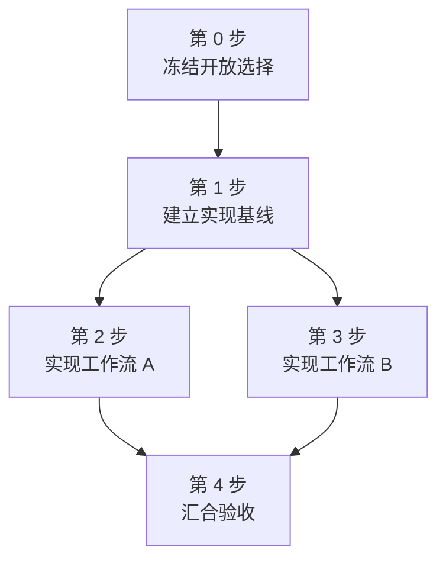

# <项目名> 工程执行手册

这份文档回答三个问题：下一步具体做什么、做完应该看到什么、怎样才算验收通过。

说明它与 `FINAL_EXPERIMENT_PLAN.md`、最后适用的 `ROUND_<NN>_BUG_LIST.md` 的关系。科学定义和
精确协议以 final plan 为准；当前代码缺口以验证后仍适用的 bug list 为准。

## 先说当前状态

用人话说明当前代码已经能做什么、哪些只是 demo/smoke/feasibility、哪些 blocker 仍阻止正式
实验。指出工作目录、版本、数据或环境方面会影响实施的现实约束。

用一句话给出依赖顺序：先完成哪些基础工程和硬门禁，何时才能打开正式数据或启动昂贵运行，
最后怎样进入离线分析和 claim handoff。

## 全局完成标准

- 一次运行在什么条件下才可标记为正式结果。
- 哪些代码、数据、配置、环境和模型身份必须可追溯。
- 哪些自动验收和人工审核必须完成。

## 第 0 步：先冻结尚未写死的选择

仅在 passing review、final plan 或 bug list 仍有会影响实现或分析的开放选择时保留本节；否则
从第 1 步开始。不得在看到结果后再选择统计口径、数据切分、模型变体或展示规则。

### 要做什么

写出要冻结的配置字段、decision rule、文件集合或人工决定，以及它们应落到哪里。若 final
plan、bug list、review 和代码中的名称、数量、路径或命令不一致，逐项列出冲突形式并冻结唯一
映射，不能静默猜测。

### 达成效果

说明冻结后工程人员不再需要临场选择什么。

### 怎么验收

给出配置 round-trip、schema 拒绝、唯一值检查或签字确认等客观门槛。

## 第 1 步：建立可追踪的实现基线

根据实际项目替换标题和内容。后续所有步骤按依赖顺序继续编号。

### 要做什么

点名具体目录、文件、模块、配置、命令或人工工作。说明哪些已存在、哪些要新增、哪些当前有
缺陷。把前置条件写在这里。

### 达成效果

说明完成后系统新增的可观察能力，不要只说“完成适配”或“提高可靠性”。

### 怎么验收

列出可以直接执行或逐项核对的验收：命令退出状态、文件和 schema、精确数量、hash、等式、
阈值、fixture 结果、完整网格或签字审核。不能只写“测试通过”。

## 第 2 步：<下一个依赖动作>

为 bug list 中仍适用的 blocker、final plan 的 deterministic gate、development smoke、release
freeze、每个正式实验、离线分析和最终证据锁定继续建立步骤。只有在共享同一实现边界和验收
门禁时才合并 blocker。

### 要做什么

保留 final plan 中的精确路径、命令、版本、hash、seed、预算和输出 schema。

### 达成效果

说明这一步为哪个后续实验解除阻塞，以及完成后能观察到什么。

### 怎么验收

保留 final plan 和 bug list 中的精确计数、阈值、失败语义和停止规则，不自行发明数字。

## 全程必须遵守的停止条件

- 前置 gate 失败时，明确哪些后续工作不得启动。
- 区分 infrastructure failure、scientific failure 和 semantic/protocol failure 的重试规则。
- 输入 identity、hash、grid 或 paired unit 不完整时 fail closed。
- 修复改变科学语义时升级版本，并说明哪些旧比较失效。
- 人工审核失败时不得偷偷换样本或覆盖原始记录。

## 最短可见里程碑

用短编号列出从 implementation-ready 到 paper-ready 的少量里程碑。每个里程碑必须能用前文
的客观验收结果判定，不能只按“代码写完”“实验跑完”判断。

## 步骤并发关系

实线箭头表示：前置步骤的验收门禁全部通过后，后续步骤才能开始。从同一节点分叉、彼此之间
没有依赖路径的步骤，在各自前置条件满足后可以并发。用实际步骤完整替换下面的示例，不能保留
模板节点，也不能遗漏任何编号步骤。

- `逻辑上可并发`：列出没有硬依赖路径、可以同时推进的步骤，以及只能部分提前开始的工作。
- `资源互斥`：列出共享 GPU、端口、可写目录、文件 owner 或其他资源导致的实际串行限制。
- `汇合门禁`：列出必须等待多个分支全部验收通过才能开始的步骤。
