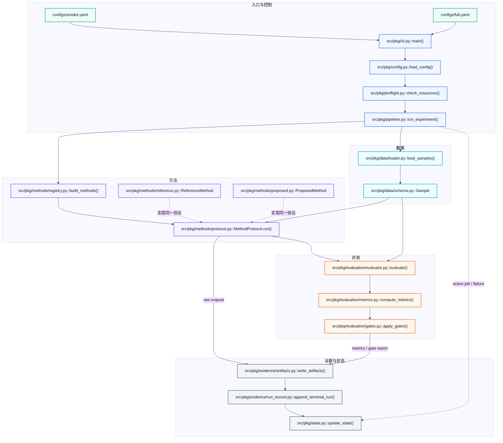
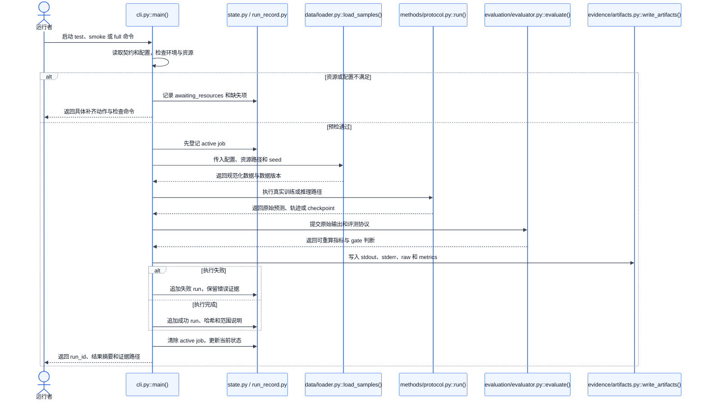

# {{SLOT}} 项目说明

> 这是项目唯一的人工入口。想复现、评审或继续开发，先读这里；需要逐项核对时，
> 再查看 `EXPERIMENT_CONTRACT.yaml`、`REQUIREMENTS.jsonl` 和 `runs/RUNS.jsonl`。
> 这些机器文件才是最终依据，本页只负责把它们讲明白，不重复制造另一套事实。

## 1. 先看这里

- **要验证什么：** <!-- 请填写：用一句话说明核心问题和可观察对比。 -->
- **现在做到哪一步：** <!-- 请填写：当前 phase/status、已完成范围和最新 review。 -->
- **已经确认的事实：** <!-- 请填写：只写有 run_id 和原始证据支撑的 smoke/full 观察。 -->
- **还不能下的结论：** <!-- 请填写：说明尚未执行的 full 范围或证据缺口。 -->
- **下一位接手者先做什么：** <!-- 请填写：给出一个最短、可执行的下一步。 -->

## 2. 项目架构

这个项目从 Mini Experiment 阶段开始就按六个职责组织：**契约与配置、数据、方法、
评测、运行编排、证据**。后续工作可以增加数据集、方法、指标和配置，但不要绕过公共
接口另起一条执行链，也不要让评测逻辑散落进方法实现。这样 smoke 和 full 始终走同一套
代码，实验变大时只换规模和配置，不换口径。

下面的图不是概念示意图。每个执行节点都要写成真实的 `相对路径.py::函数或类`，箭头表示
实际调用或数据传递。新项目可以采用图中的推荐文件名；复用框架时，把所有 `src/pkg/...`
替换为框架里的真实文件和符号。<!-- 请填写：实现完成后删除本句，并确认图中路径都真实存在。 -->



### 真实文件怎么对应

现成框架可以保留自己的目录名，但下面六个职责必须各有明确归属。表格要精确到 `.py`
文件和主要符号，不能只写“数据模块”或“评测层”。新写项目优先使用图中这组直观边界。

| 职责 | 真实路径/入口 | 输入 | 输出 | 后续允许怎么扩展 |
|---|---|---|---|---|
| 契约与配置 | <!-- 请填写：契约和配置路径。 --> | 想法文档、资源约束 | 冻结协议、smoke/full 配置 | 新增版本化配置，不改历史口径 |
| 数据 | <!-- 请填写：数据生成或加载入口。 --> | 原始资源、seed、配置 | 规范化样本/批次 | 新增数据适配器，不泄漏评测标签 |
| 方法 | <!-- 请填写：统一方法接口和实现。 --> | 样本/批次、配置 | 原始预测、轨迹或 checkpoint | 在同一协议下增加方法 |
| 评测 | <!-- 请填写：scorer/evaluator 入口。 --> | 原始输出、真值、资格规则 | 指标和 gate 判断 | 增加指标时保留原始输出可重算 |
| 运行编排 | <!-- 请填写：CLI、pipeline 或 runner。 --> | 命令、配置、资源 | 一次完整运行 | smoke/full 只改变规模参数 |
| 证据 | `runs/`、`runs/RUNS.jsonl` | 日志、原始输出、指标、哈希 | 可审计 run receipt | 只追加新 run，不改写旧记录 |

### 目录和公共接口

```text
<!-- 请填写：列出重要目录、入口和所有权；不用展开缓存、依赖包和无关文件。 -->
```

| 公共接口 | 位置 | 调用约定 | 谁会调用 |
|---|---|---|---|
| <!-- 请填写：例如统一方法协议。 --> | | | |
| <!-- 请填写：例如评测入口。 --> | | | |
| <!-- 请填写：例如端到端 CLI。 --> | | | |

## 3. 一次运行是怎么走的

下面画的是测试、smoke 和 full 共同遵守的时序。三者的差别只能是样本数、步数、重复数
或启用的方法数量，不能偷偷换算法、评分器或输出格式。



### 这条链在本项目里的实际入口

<!-- 请填写：按上图顺序，用 5-10 句话说明真实函数/模块如何协作，以及失败会在哪里显式暴露。 -->

## 4. 怎么运行

### 环境和资源

- 环境激活命令：<!-- 请填写：精确命令。 -->
- 依赖版本或 lockfile：<!-- 请填写：路径/版本。 -->
- 复用框架及 revision/license：<!-- 请填写：没有则写“无，独立实现”并说明原因。 -->
- 数据集/权重及版本、哈希：<!-- 请填写：只记只读路径和公开来源，不写密钥值。 -->
- 缓存与输出目录：<!-- 请填写：必须位于本实验目录。 -->
- 凭据环境变量名：<!-- 请填写：只写变量名；没有则写“无”。 -->

如果资源尚未齐全，把缺失项和验证命令写在这里，同时同步到
`EXPERIMENT_STATE.json.resource_gate` 与 `pending_actions`。

### 必跑测试

```bash
<!-- 请填写：与契约 acceptance.required_test_commands 完全一致。 -->
```

### Canonical smoke

```bash
<!-- 请填写：与契约 acceptance.smoke_command 完全一致。 -->
```

### Full experiment

```bash
<!-- 请填写：已实现的完整命令；未执行时必须明确标注。 -->
```

| 缩减维度 | Full | Smoke | 为什么没有改变实验语义 |
|---|---|---|---|
| <!-- 请填写：样本、步数、重复次数等。 --> | | | |

## 5. 当前证据和结论边界

### 已验证观察

每个数字都要能追到 run、原始文件和派生指标。这里只写摘要，不复制完整运行账本。

| 观察 | 值 | Run ID | 运行范围 | 原始证据 | 指标文件 | 限制 |
|---|---:|---|---|---|---|---|
| <!-- 请填写：没有已执行结果时明确写“暂无”。 --> | | | | | | |

### 科学门槛

| Gate | 观察值与不确定性 | 阈值口径 | 是否通过 | Run/证据 | 失败后做什么 |
|---|---|---|---|---|---|
| <!-- 请填写：不得事后修改 idea 定义的阈值。 --> | | | | | |

### 还没有验证的部分

<!-- 请填写：full 是否执行、为什么没执行、已知失败、负结果、证据缺口和不能支持的 claim。 -->

## 6. 后续怎么增量扩展

后续开发默认沿用本页架构，按下面顺序加东西：先在 `REQUIREMENTS.jsonl` 增加或更新原子
需求，再扩展对应组件与测试，最后追加新的 run 证据。除非已经证明现有职责边界无法容纳
新需求，否则不要复制 runner、scorer 或结果管线。

### 下一步

1. <!-- 请填写：当前最优先且可执行的动作。 -->
2. <!-- 请填写：依赖第一步的增量工作。 -->
3. <!-- 请填写：明确延后的昂贵 full run 或非核心工作。 -->

### 接手和评审入口

- 最值得先读的实现：<!-- 请填写：高风险路径和关键符号。 -->
- 最值得先跑的命令：<!-- 请填写：最小测试或 canonical smoke。 -->
- 最值得先核对的证据：<!-- 请填写：run_id、raw、metrics 和 manifest。 -->
- 已知限制/待决策：<!-- 请填写：需要人类判断或外部资源的事项。 -->
